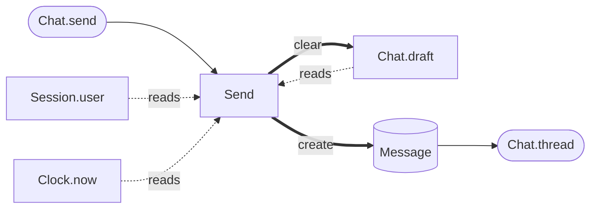

<h1 align="center">Miracle</h1>

<p align="center"><b>읽으면 보이는 앱.</b></p>

<p align="center">본문을 열지 않아도, 실행하지 않아도.<br>코드의 모양이 곧 앱의 설명이 된다.</p>

<br>

## Model · Interface · System

**Model** 무엇이 있나.\
**Interface** 바깥과 무엇을 주고받나.\
**System** 그래서 무엇이 바뀌나.

앱은 이 세 가지로 끝난다.

<br>

## 이렇게 쓰고

```miracle
model Message
  author  User
  text    Text
  sentAt  Time

interface Chat
  screen "채팅"
    list thread  of=Message  sort=sentAt
    input draft  placeholder="메시지"
    button send  "보내기"

system Send  on Chat.send
  when Chat.draft != ""
    create Message  author=Session.user  text=Chat.draft  sentAt=Clock.now
    clear Chat.draft
```

한 줄에 하나. 왼쪽 끝만 훑어도 구조가 보인다.

## 이렇게 보인다

읽기와 쓰기는 적지 않았다. Miracle이 찾아낸다.

```
Send   on      Chat.send
       reads   Chat.draft · Session.user · Clock.now
       writes  + Message   ~ Chat.draft
```



## "만약 이 값이라면"

주석에 쓰던 `// ex) qty = 3` 을 그대로 쓴다. Miracle은 그걸 돌린다.

```miracle
model Line
  product  Product  ? 펜
  qty      Number   ? 3
  amount = .product.price * .qty                    → 3000

model Cart  single
  lines  List<Line>   ? [Line product=펜 qty=3]
  total = sum(.lines.amount)   ! 3000                → 3000 ✓
```

`?` 는 사람이 적는 가정, `→` 는 에디터가 그리는 결과, `!` 는 지켜야 할 기대.\
값을 고치면 아래가 바로 다시 돈다. 컴파일도, 실행 버튼도 없다.

## 쌓이면 묶는다

줄을 고르고 묶으면 그 자리에서 component 가 된다. 무엇을 받을지는 이미 알고 있다.

```
  for line in Cart.lines                  for line in Cart.lines
┃   when line.product.stock < line.qty  →   RequireStock  of=line
┃     fail OutOfStock  product=…
```

없는 이름은 일단 쓴다. 나중에 채운다. 위에서 아래로도, 아래에서 위로도.

<br>

## 화면이 없어도, 같은 모양

파일, 네트워크, 시계도 전부 Interface다.

```miracle
interface Disk
  watch changed  "~/sync"

model Sync  single
  dirty  Set<Path>

system Mark  on Disk.changed
  add Disk.changed.path to Sync.dirty
```

```
Mark   on      Disk.changed
       reads   Disk.changed.path
       writes  ⊕ Sync.dirty
```

채팅 앱과 동기화 데몬이 같은 세 단어로 읽힌다.

<br>

## 약속

**모양이 곧 문서다.** 모양과 실제가 어긋나면 그 자리에서 멈춘다.\
**한 번만 쓴다.** 본문에서 알 수 있는 건 다시 적지 않는다.\
**늘 돌아간다.** 고치는 순간 값과 결과가 따라온다.\
**일부러 덜 허락한다.** 숨은 부작용이 없어야 모양을 믿을 수 있다.

<br>

<p align="center">
  <a href="SPEC.md">명세</a> · <a href="docs/EDITOR.md">에디터</a> · <a href="examples">예제</a> · <a href="editor">프로토타입</a>
</p>

<p align="center"><sub>Miracle은 아직 설계 중이다. 문법도, 출력도 바뀐다.</sub></p>
